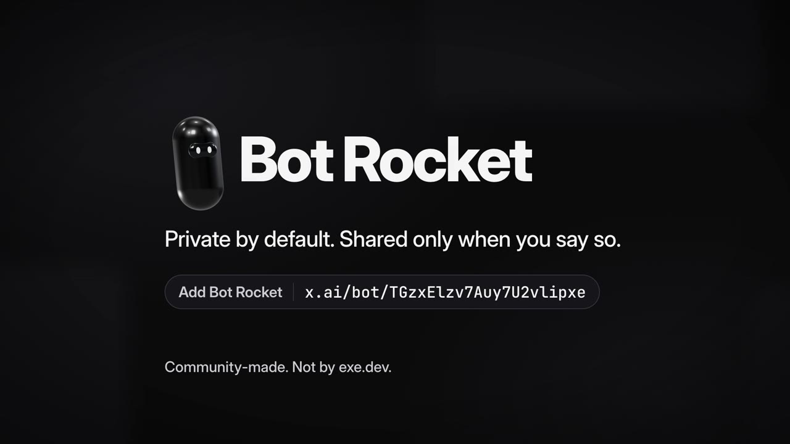

# Bot Rocket skills

These are the pinned skills that Bot Rocket installs for itself on first run. Bot Rocket is a Grok Bot Custom Template by GitMaxd for hosting what your Bots build on your own exe.dev VMs.

You don't need to install anything from here. To get the bot, use the [Bot Rocket template link](https://x.ai/bot/TGzxElzv7Auy7U2vlipxe), and it fetches these files after you say yes.

*The launch video runs 28 seconds. Click the image to play it.*

MIT licensed. See [LICENSE](LICENSE).
